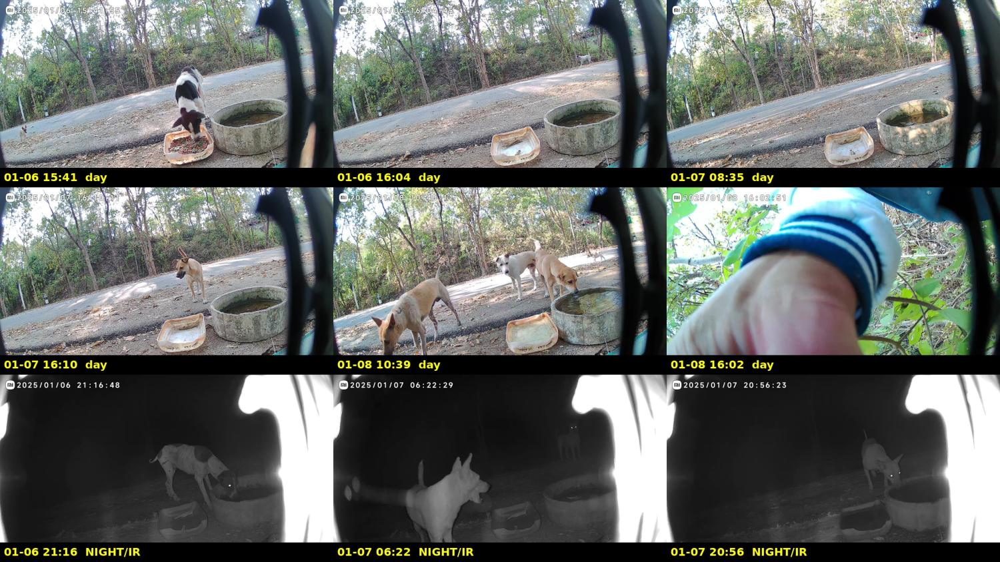
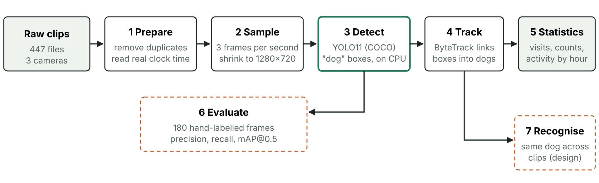
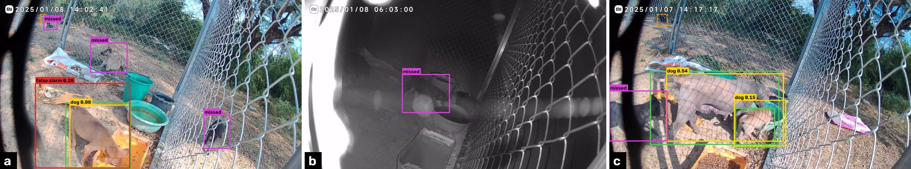

# Detecting and locating stray dogs in raw camera footage from Chiang Mai

*Technical report · CMKL course assignment · repository: `Epp-ppE/stray-dog-detection`*

## Summary

Cameras at three community feeding spots in Chiang Mai recorded 447 motion-triggered clips
(6–8 January 2025) with no labels. This project builds a CPU-only pipeline that finds and
locates dogs in that footage, follows each dog through a clip, and turns the result into
visit and activity statistics per camera. Before any modelling, two hidden problems in the
data were found and fixed: 22 duplicate files, and wrong timestamps in Camera1's filenames,
which were recovered from the clock burned into the video. Because no labels existed, 180
frames were chosen at random and hand-labelled (332 dogs), split by clip into a **dev** half
for tuning and a **test** half for reporting. Nine detector setups were compared. A
COCO-pretrained **YOLO11m at 960 px, counting every animal class as "dog"**, reached
**AP@0.5 = 0.75 [95% CI 0.67–0.83]** and **F1 = 0.78** on the test half, against 0.44 and
0.54 for the YOLO11s baseline. The largest single gain came from counting every animal
class as dog, because the pretrained model often calls puppies "cat" and calls dogs in
night-time infrared "sheep" or "cow". The main remaining failures are small or far-away
dogs, dark dogs in infrared, dogs behind the chain-link fence, and groups of overlapping
puppies. A design for recognising individual dogs across clips is given, with a small
untrained demo.

---

## 1. Data

| Camera | Scene | Files | Unique clips | Footage | Night (infrared) clips |
|---|---|---|---|---|---|
| Camera1 (A) | Fenced feeding area, bowls, chain-link fence | 341 | 341 | 116.6 min | 58 |
| Camera3 (C) | Water trough by a forest road | 74 | 73 | 26.0 min | 7 |
| Camera4 (D) | Bench beside a building, behind plants | 32 | 11 | 4.0 min | 0 |
| **Total** | | **447** | **425** | **2.44 h** | **65** |

All clips are 2560×1440, 15 fps, H.265 with audio, 3–30 s long (median about 20 s), from
Xiaomi cameras with a wide-angle lens. Night clips are black-and-white infrared with strong
glare near the lens.

*Figure 1. Camera3, day and infrared night. Dogs range from close-up to a few dozen pixels on the far road.*

**Duplicates.** File fingerprints (MD5) showed 22 byte-identical copies. Twenty-one are
Camera4 files saved two or three times (`(1)`, `(2)` suffixes) and one is a re-shared
Camera3 file. Counting them would double- or triple-count visits. One copy of each is kept.

**Wrong timestamps.** Camera3/4 filenames are Unix-millisecond start times that match the
on-screen clock. Camera1 filenames (`VIDEO_20250108_161610468`) all fall between 16:16 and
18:24 on 8 January, but the burned-in clock shows recordings across 6–8 January,
including at night: the names are export times. Time-of-day statistics need the real time,
so it was read from the overlay. General text recognition (Tesseract) read only 2 of 20
test clips, because the white digits disappear against bright sky (Figure 2). Since the
font, size and position never change, each of the 14 digit positions is instead cut out
and classified separately (HOG features, 3-nearest-neighbours). Training labels came free
from Camera3/4, whose filenames give the true time of every frame. On 25 held-out clips:
**99.5%** of digits correct, **93.4%** of single-frame timestamps fully correct, and every
clip start time (median over all frames of the clip) **within 0.13 s**. On every Camera1
clip at least 80% of the frames agree on the start time.

*Figure 2. The clock strip after four kinds of image clean-up. A person reads it easily; general text recognition does not.*

## 2. Pipeline

| Step | What | Why |
|---|---|---|
| 1. Prepare | Remove duplicates; recover real start times | Avoid double counting; correct time of day |
| 2. Sample | 3 frames/s, shrunk to 1280×720 (ffmpeg drops frames before shrinking) | No GPU. Neighbouring frames at 15 fps are almost identical, and 3 fps still follows a walking dog. 5× less compute |
| 3. Detect | COCO-pretrained YOLO11; every COCO animal class counted as dog; class-agnostic NMS (IoU 0.6) removes duplicate boxes on one animal; all boxes ≥ 0.01 stored | No labels to train on, so a strong pretrained detector is the honest baseline. Storing low-confidence boxes lets thresholds be tuned without re-running the model |
| 4. Track | ByteTrack per clip; a track is a confirmed dog only if it lasts long enough and is confident at least once; settings chosen on the dev clips | Removes one-frame flickers; gives time on screen and movement per dog |
| 5. Statistics | Visits, dogs per visit, dog-minutes by hour, moving vs resting, close contact | The information a vaccination or sterilisation team needs |

**Model choice.** YOLO11 comes in several sizes; n, s and m were compared at 640 px input
and s and m at 960 px. A larger input helps small, far-away dogs (Camera3's road), and a
larger model helps hard poses and infrared. Speed on the 4-core CPU used here: 41 / 83 /
226 ms per frame at 640 px (n / s / m), and 204 / 492 ms at 960 px (s / m).

**Counting every animal class as dog.** COCO has no "puppy" class, and its night images
are colour photos, not infrared. Of the labelled dogs the final model found, 26% had a
non-dog class as their most confident label (mostly "cat"), and 52% at night. Counting all
animal classes (cat, dog, horse, sheep, cow, bear) as dog recovers these. The cost is that
real cats or livestock would also be counted as dogs. No other animals appeared in the 180
labelled frames, but a deployment near farms would need a check.

**Thresholds.** Every confidence threshold was chosen on the dev half only (best F1). The
chosen box thresholds are very low (0.01–0.04), because this footage is far from COCO's
photos and the model's confidence is badly calibrated for it: many correct dog boxes score
below 0.1. At the common default of 0.25, the final setup keeps 98% precision but recall
drops from 0.75 to 0.60.

**Statistics definitions.**
* *Dogs in a clip:* the most confirmed tracks visible in any one frame. This is a lower bound
  on distinct dogs that does not grow when the tracker loses and re-finds a dog.
* *Dog-seconds:* the number of dogs in each frame, summed and divided by 3 frames per second.
* *Visit:* consecutive clips with dogs on one camera, merged when the gap is ≤ 2 minutes
  (the camera records bursts of short clips).
* *Moving vs resting:* box-centre speed in body lengths per second, using box height as a
  proxy for body length. Above 0.25 counts as moving.
* *Close contact:* two dogs whose box centres are closer than their average box width.

## 3. Evaluation methodology

**Labelled set.** 180 frames from 115 clips were drawn at random **before any model output
was seen**, stratified by camera and day/night (Camera1 50 day + 20 night, Camera3 45 + 15,
Camera4 50 day). At most 2–6 frames come from one clip, at least 3 s apart, because
neighbouring frames are near-copies. The frames are pixel-identical to what the detector
sees. They were labelled in a purpose-built browser tool with a written guide:
* one box per dog, covering its visible extent only;
* a **hard** flag for dogs less than about a quarter visible or too small or unclear to be sure;
* fixed background objects (a rock that appears in every Camera1 frame) are not dogs.

The result: 332 dog boxes, 28 hard boxes and 20 frames with no dog. No frames were skipped.

**Split.** Whole clips are assigned to **dev** (87 frames) or **test** (93 frames), so no
clip appears in both. Thresholds, the tracker settings and the choice of final setup use
dev only. Headline numbers are test numbers.

**Matching and metrics.** A predicted box is a true positive if its IoU with a not-yet-matched
dog box is ≥ 0.5 (greedy, most confident first). Predictions on hard boxes are ignored, and
missed hard boxes are not counted as misses. Reported: AP@0.5 (all-point interpolated area
under the precision–recall curve; with one class, mAP@0.5 = AP@0.5), plus precision,
recall and F1 at the dev-chosen threshold. 95% intervals come from 1,000 bootstrap
resamples of the test frames.

**Baselines and comparisons.** The baseline is the default choice: YOLO11s at 640 px with
the "dog" class only. It is compared with model size (n/s/m), input size (640/960), counting
other animal classes, and the tracking filter.

## 4. Results

### 4.1 Detector comparison (test half)

| Setup | dev AP50 | threshold | test AP@0.5 [95% CI] | precision | recall | F1 [95% CI] |
|---|---|---|---|---|---|---|
| YOLO11n @640 | 0.32 | 0.015 | 0.34 [0.26–0.42] | 0.77 | 0.34 | 0.48 [0.39–0.55] |
| YOLO11s @640 *(baseline)* | 0.50 | 0.023 | 0.44 [0.36–0.52] | 0.71 | 0.44 | 0.54 [0.47–0.62] |
| YOLO11m @640 | 0.56 | 0.029 | 0.57 [0.49–0.65] | 0.91 | 0.56 | 0.70 [0.63–0.76] |
| YOLO11s @960 | 0.56 | 0.043 | 0.48 [0.40–0.56] | 0.82 | 0.46 | 0.59 [0.52–0.66] |
| YOLO11m @960 | 0.61 | 0.010 | 0.58 [0.49–0.67] | 0.84 | 0.59 | 0.69 [0.61–0.76] |
| YOLO11s @640 + animals | 0.71 | 0.044 | 0.64 [0.57–0.71] | 0.77 | 0.61 | 0.68 [0.62–0.74] |
| YOLO11m @640 + animals | 0.75 | 0.025 | 0.69 [0.62–0.75] | 0.87 | 0.67 | 0.76 [0.70–0.81] |
| **YOLO11m @960 + animals** *(final)* | **0.79** | 0.017 | **0.75 [0.67–0.83]** | 0.81 | **0.75** | **0.78 [0.71–0.83]** |
| YOLO11s @640 + tracking *(original settings)* | 0.34 | 0.145 | 0.31 [0.23–0.40] | 0.98 | 0.31 | 0.47 [0.38–0.56] |

*Figure 3. Precision–recall on the test half for all setups.*

* **Model size matters more than input size.** Going from s to m adds 0.13 AP at 640 px.
  Going from 640 to 960 px adds little for m (0.57 to 0.58) but helps when combined with
  counting other animals (0.69 to 0.75).
* **Counting other animal classes is the biggest single gain**: +0.20 AP for s@640 and
  +0.17 for m@960. The final setup is selected by dev AP, where it also ranks first.
* **Recall, not precision, is the limit.** At their chosen thresholds all setups have
  precision 0.7–0.9. Missed dogs dominate the errors.
* **The tracking filter with its original settings** (tuned by hand for YOLO11s at 640
  px) reaches 98% precision but keeps only 31% of dogs. Its thresholds were set far above
  where this footage's correct boxes score, so the tracker was re-tuned for the final
  setup (section 4.3).

### 4.2 Where it works and where it fails

Final setup, at its dev-chosen threshold, on all 180 labelled frames:

| Subset | Frames | Dogs | AP@0.5 | Precision | Recall | Baseline AP |
|---|---|---|---|---|---|---|
| Camera1 (fenced area) | 70 | 132 | 0.70 | 0.87 | 0.70 | 0.41 |
| Camera3 (trough, road) | 60 | 121 | 0.82 | 0.86 | 0.84 | 0.60 |
| Camera4 (bench, plants) | 50 | 79 | 0.79 | 0.80 | 0.80 | 0.34 |
| Day | 145 | 291 | 0.77 | 0.83 | 0.77 | 0.48 |
| Night (infrared) | 35 | 41 | 0.76 | 0.97 | 0.76 | 0.35 |

| Dog size (share of frame area) | Dogs | Recall |
|---|---|---|
| tiny (< 0.2%) | 9 | 0.33 |
| small (0.2–1%) | 90 | 0.57 |
| medium (1–5%) | 133 | 0.83 |
| large (> 5%) | 100 | 0.93 |

Of the 180 frames, 109 are fully correct, 51 have at least one missed dog and 20 have at
least one false alarm. The full gallery is in `outputs/examples/`. Green boxes are hand
labels, yellow are correct detections, red are false alarms, magenta are missed dogs and
dashed orange are hard (ignored) labels.

*Figure 4. Successes. (a) Camera3: six dogs, four of them tiny on the far road, found at
confidences as low as 0.02. (b) Camera1 at night: four dogs including a pile of puppies,
in infrared. (c) Camera4 against the sun: dogs in plants and behind the bench.*

*Figure 5. False alarms. (a) A pile of puppies gets an extra box spanning two of them.
(b) Part of the motorbike and rider is boxed at 0.02 confidence. (c) A dog lying in plants
gets a second, shifted box.*

*Figure 6. Missed dogs. (a) Dark puppies at the back of Camera1's enclosure and a dog
behind the fence mesh are missed; a loose box over a dog and the food tray counts as a
false alarm. (b) A dog at the bowl at night, washed out by infrared glare. (c) A black dog
cut off at the lens edge and pressed against other dogs.*

### 4.3 Tracking and behaviour statistics

<!-- TRACKING -->

## 5. Limitations and failure modes

* **Small and far-away dogs.** Recall falls from 0.93 for large dogs to 0.57 for small and
  0.33 for tiny ones. Far dogs on Camera3's road and at the back of Camera1's enclosure are
  the most common misses. Tiling the frame, or a higher input resolution where a GPU is
  available, would help.
* **Lighting.** Infrared night frames lose colour and texture, and glare washes out dogs
  near the lens. Night recall (0.76) matches day only because other animal classes are
  counted. Backlight and lens flare at Camera4 lower confidences.
* **Occlusion.** The chain-link fence covers all of Camera1's view, and plants, bowls and
  the lens housing hide parts of dogs. Puppies pile on top of each other at the food. Groups
  produce both misses (one box for two dogs) and false alarms (an extra box spanning two).
* **Calibration.** Correct boxes often score below 0.1, so the useful threshold (about 0.02)
  is far below the usual 0.25. It was set on dev data from these same cameras; a new camera
  or season would need re-checking.
* **Domain gap.** The detector never saw this footage, puppies, infrared or wide-angle
  distortion. Fine-tuning on a few hundred labelled frames would likely be the largest
  remaining improvement; this project's labels are reserved for honest evaluation.
* **Small evaluation set.** 93 test frames give wide intervals (about ±0.08 AP), and Camera4
  has only 11 clips. Differences between neighbouring setups (e.g. m@640+animals vs
  m@960+animals) are within the noise.
* **Stray vs owned.** The detector finds dogs, not stray dogs. Collars, owners and context
  would be needed to tell them apart.
* **Counting.** "Dogs in a clip" is a lower bound: dogs off-screen or missed are not
  counted, and the same dog in two visits is counted twice. Telling dogs apart needs
  recognition (section 6).
* **Three days of data.** Hour-of-day patterns come from few days and depend on when people
  feed the dogs. They describe these three days, not a general routine.
* **People.** Feeders and a person on a motorbike appear. Person detections are not used,
  and recognition is limited to dogs.

## 6. Dog recognition

The full design is in `docs/recognition_design.md`. In short:

* **Unit of recognition: the track.** Several crops of one dog are averaged. The tracker
  links within a clip; recognition links across clips.
* **Free training signal.** Crops in one track are the same dog (positive pairs). Two tracks
  in the same frame are different dogs (hard negative pairs). A person then joins tracks
  into named dogs for a test set of 20–30 dogs.
* **Model.** Start with a pretrained backbone. Fine-tune with a metric-learning loss
  (triplet or ArcFace) on public animal re-identification data, then on local tracks. Use
  part-based features for partly hidden dogs, and a separate, stricter night gallery
  because colour disappears.
* **Matching.** Cosine similarity, plus time and place: same camera within minutes means
  probably the same dog, and two dogs in the same frame can't be one dog. An open-set
  threshold decides "new dog", and a person confirms unsure links.
* **Evaluation.** Rank-1/5 accuracy, re-ID mAP, pairwise precision and recall of links,
  and error in the count of distinct dogs, split by day/night and same/other camera.
* **Challenges.** Look-alike puppies, infrared, mostly top-down head-in-bowl views, fence
  and plants, puppies growing, lens distortion and short clips.

<!-- REID -->

## 7. Reproducibility

Everything is in the repository. `bash scripts/run_all.sh` downloads the footage from the
GitHub release, downloads model weights and runs every step. The README lists the steps
and times. Hand labels, the evaluation-frame list, the cached predictions on the evaluation
frames, all metrics, tracks and statistics are committed under `outputs/`. Random choices
use fixed seeds. Software versions are pinned in `requirements.txt`.

## 8. Next steps

1. Fine-tune the detector on a few hundred labelled frames from these cameras, especially
   puppies, infrared and the fenced view.
2. Tile large frames, or use a GPU at 1280 px, for far-away dogs.
3. Collect weeks rather than days, and label a re-identification set of 20–30 dogs to
   train and evaluate recognition.
4. Add a side-on camera at dog eye level, which would give better views for recognition.
