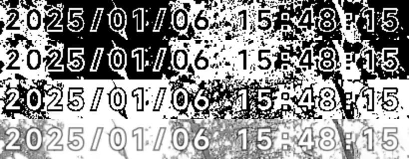
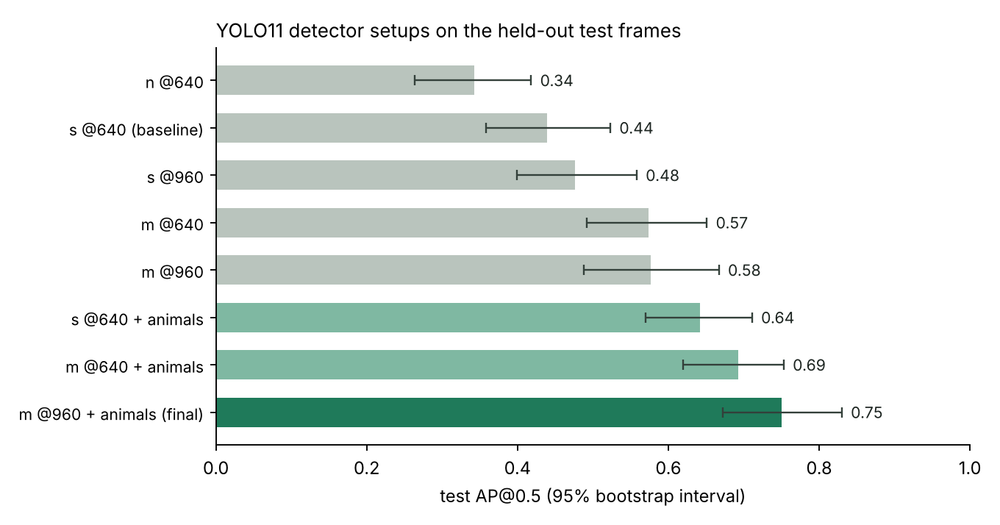
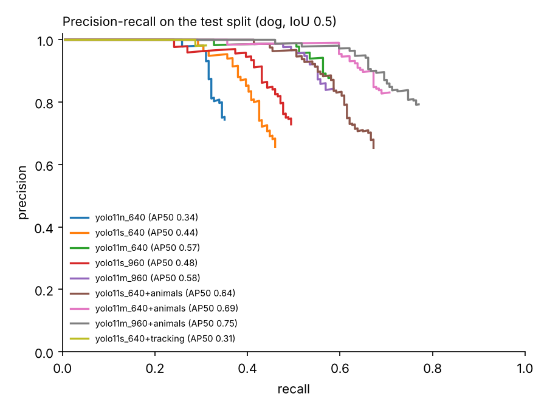
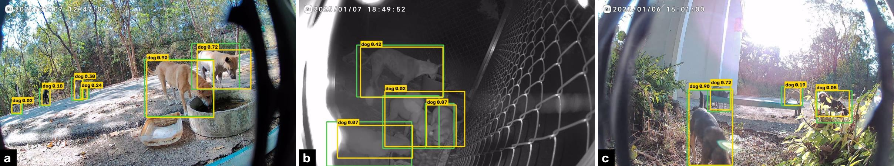
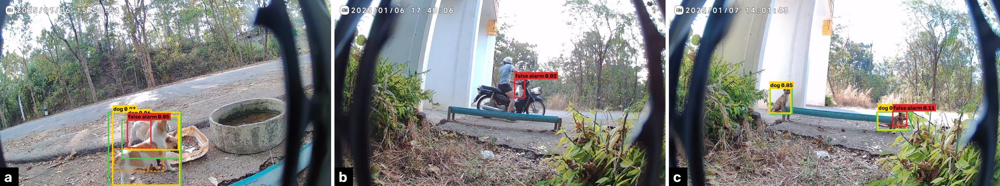
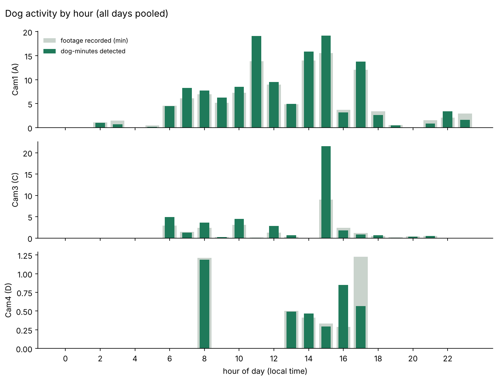
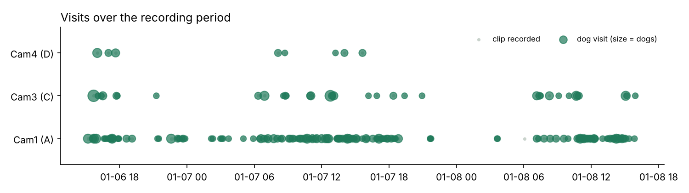
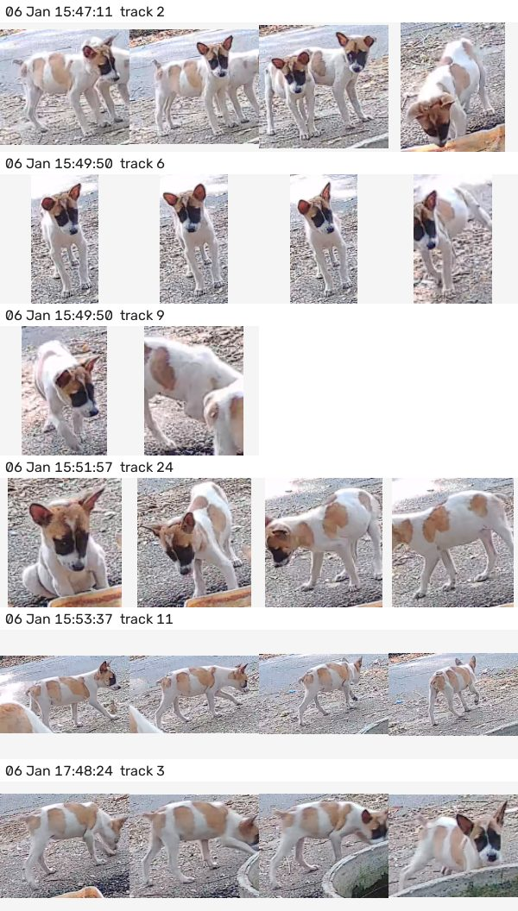
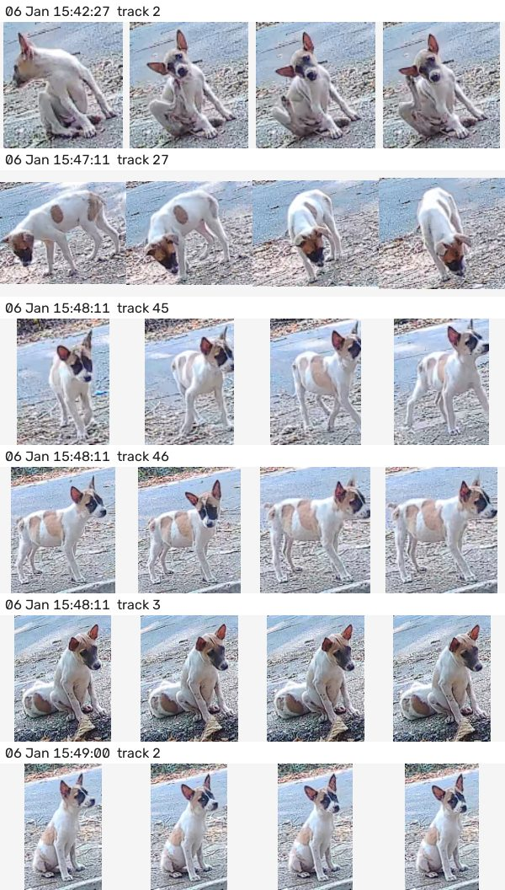

# Detecting and locating stray dogs in raw camera footage from Chiang Mai

**Phupa Denphatcharangkul** · Student ID 01223049

*Technical report · CMKL course assignment · repository: `Epp-ppE/stray-dog-detection`*

## Summary

Cameras at three community feeding spots in Chiang Mai recorded 447 motion-triggered clips
(6–8 January 2025) with no labels. This project builds a CPU-only pipeline that finds and
locates dogs in that footage, follows each dog through a clip, and turns the result into
visit and activity statistics per camera. Before any modelling, two hidden problems in the
data were found and fixed: 22 duplicate files, and wrong timestamps in Camera1's filenames,
which were recovered from the clock burned into the video. Because no labels existed, 180
frames were chosen at random and hand-labelled (332 dogs), split by clip into a **dev** half
for tuning and a **test** half for reporting. Eight detector setups were compared, plus two with tracking. A
COCO-pretrained **YOLO11m at 960 px, counting every animal class as "dog"**, reached
**AP@0.5 = 0.75 [95% CI 0.67–0.83]** and **F1 = 0.78** on the test half, against 0.44 and
0.54 for the YOLO11s baseline. The largest single gain came from counting every animal
class as dog, because the pretrained model often calls puppies "cat" and calls dogs in
night-time infrared "sheep" or "cow". The main remaining failures are small or far-away
dogs, dark dogs in infrared, dogs behind the chain-link fence, and groups of overlapping
puppies. On all 425 clips, tracking with settings tuned on dev keeps 95% precision at 54%
recall, and gives conservative statistics: Camera1's feeding area sees about 45 dog visits
a day, mostly in daylight, and dogs spend under a quarter of their time moving. A design
for recognising individual dogs across clips is given, with a small untrained demo that
groups 150 Camera3 tracks into 72 candidate dogs.

---

## 1. Data

| Camera | Scene | Files | Unique clips | Footage | Night (infrared) clips |
|---|---|---|---|---|---|
| Camera1 (A) | Fenced feeding area, bowls, chain-link fence | 341 | 341 | 116.6 min | 58 |
| Camera3 (C) | Water trough by a forest road | 74 | 73 | 26.0 min | 7 |
| Camera4 (D) | Bench beside a building, behind plants | 32 | 11 | 4.0 min | 0 |
| **Total** | | **447** | **425** | **2.44 h** | **65** |

All clips are 2560×1440, 15 fps, H.265 with audio, 3–30 s long (median about 20 s), from
Xiaomi cameras with a wide-angle lens. Night clips are black-and-white infrared with strong
glare near the lens.


*Figure 1. Camera3, day and infrared night. Dogs range from close-up to a few dozen pixels on the far road.*

**Duplicates.** File fingerprints (MD5) showed 22 byte-identical copies. Twenty-one are
Camera4 files saved two or three times (`(1)`, `(2)` suffixes) and one is a re-shared
Camera3 file. Counting them would double- or triple-count visits. One copy of each is kept.

**Wrong timestamps.** Camera3/4 filenames are Unix-millisecond start times that match the
on-screen clock. Camera1 filenames (`VIDEO_20250108_161610468`) all fall between 16:16 and
18:24 on 8 January, but the burned-in clock shows recordings across 6–8 January,
including at night: the names are export times. Time-of-day statistics need the real time,
so it was read from the overlay. General text recognition (Tesseract) read only 2 of 20
test clips, because the white digits disappear against bright sky (Figure 2). Since the
font, size and position never change, each of the 14 digit positions is instead cut out
and classified separately (HOG features, 3-nearest-neighbours). Training labels came free
from Camera3/4, whose filenames give the true time of every frame. On 25 held-out clips:
**99.5%** of digits correct, **93.4%** of single-frame timestamps fully correct, and every
clip start time (median over all frames of the clip) **within 0.13 s**. On every Camera1
clip at least 80% of the frames agree on the start time.


*Figure 2. The clock strip after four kinds of image clean-up. A person reads it easily; general text recognition does not.*

## 2. Pipeline


| Step | What | Why |
|---|---|---|
| 1. Prepare | Remove duplicates; recover real start times | Avoid double counting; correct time of day |
| 2. Sample | 3 frames/s, shrunk to 1280×720 (ffmpeg drops frames before shrinking) | No GPU. Neighbouring frames at 15 fps are almost identical, and 3 fps still follows a walking dog. 5× less compute |
| 3. Detect | COCO-pretrained YOLO11; every COCO animal class counted as dog; class-agnostic NMS (IoU 0.6) removes duplicate boxes on one animal; all boxes ≥ 0.01 stored | No labels to train on, so a strong pretrained detector is the honest baseline. Storing low-confidence boxes lets thresholds be tuned without re-running the model |
| 4. Track | ByteTrack per clip; a track is a confirmed dog only if it lasts long enough and is confident at least once; settings chosen on the dev clips | Removes one-frame flickers; gives time on screen and movement per dog |
| 5. Statistics | Visits, dogs per visit, dog-minutes by hour, moving vs resting, close contact | The information a vaccination or sterilisation team needs |

**Model choice.** YOLO11 comes in several sizes; n, s and m were compared at 640 px input
and s and m at 960 px. A larger input helps small, far-away dogs (Camera3's road), and a
larger model helps hard poses and infrared. Speed on the 4-core CPU used here: 41 / 83 /
226 ms per frame at 640 px (n / s / m), and 204 / 492 ms at 960 px (s / m).

**Counting every animal class as dog.** COCO has no "puppy" class, and its night images
are colour photos, not infrared. Of the labelled dogs the final model found, 28% had a
non-dog class as their most confident label (mostly "cat"), and 52% at night. Counting all
animal classes (cat, dog, horse, sheep, cow, bear) as dog recovers these. The cost is that
real cats or livestock would also be counted as dogs. No other animals appeared in the 180
labelled frames, but a deployment near farms would need a check.

**Thresholds.** Every confidence threshold was chosen on the dev half only (best F1). The
chosen box thresholds are very low (0.01–0.04), because this footage is far from COCO's
photos and the model's confidence is badly calibrated for it: many correct dog boxes score
below 0.1. At the common default of 0.25, the final setup keeps 98% precision but recall
drops from 0.75 to 0.60.

**Statistics definitions.**
* *Dogs in a clip:* the most confirmed tracks visible in any one frame. This is a lower bound
  on distinct dogs that does not grow when the tracker loses and re-finds a dog.
* *Dog-seconds:* the number of dogs in each frame, summed and divided by 3 frames per second.
* *Visit:* consecutive clips with dogs on one camera, merged when the gap is ≤ 2 minutes
  (the camera records bursts of short clips).
* *Moving vs resting:* box-centre speed in body lengths per second, using box height as a
  proxy for body length. Above 0.25 counts as moving.
* *Close contact:* two dogs whose box centres are closer than their average box width.

## 3. Evaluation methodology

**Labelled set.** 180 frames from 115 clips were drawn at random **before any model output
was seen**, stratified by camera and day/night (Camera1 50 day + 20 night, Camera3 45 + 15,
Camera4 50 day). At most 2–6 frames come from one clip, at least 3 s apart, because
neighbouring frames are near-copies. The frames are pixel-identical to what the detector
sees. They were labelled in a purpose-built browser tool with a written guide:
* one box per dog, covering its visible extent only;
* a **hard** flag for dogs less than about a quarter visible or too small or unclear to be sure;
* fixed background objects (a rock that appears in every Camera1 frame) are not dogs.

The result: 332 dog boxes, 28 hard boxes and 20 frames with no dog. No frames were skipped.

**Split.** Whole clips are assigned to **dev** (87 frames) or **test** (93 frames), so no
clip appears in both. Thresholds, the tracker settings and the choice of final setup use
dev only. Headline numbers are test numbers.

**Matching and metrics.** A predicted box is a true positive if its IoU with a not-yet-matched
dog box is ≥ 0.5 (greedy, most confident first). Predictions on hard boxes are ignored, and
missed hard boxes are not counted as misses. Reported: AP@0.5 (all-point interpolated area
under the precision–recall curve; with one class, mAP@0.5 = AP@0.5), plus precision,
recall and F1 at the dev-chosen threshold. 95% intervals come from 1,000 bootstrap
resamples of the test frames.

**Baselines and comparisons.** The baseline is the default choice: YOLO11s at 640 px with
the "dog" class only. It is compared with model size (n/s/m), input size (640/960), counting
other animal classes, and the tracking filter.

## 4. Results

### 4.1 Detector comparison (test half)


*Figure 3. Test AP@0.5 with 95% bootstrap intervals. Light green: every animal class counted as dog.*

| Setup | dev AP50 | threshold | test AP@0.5 [95% CI] | precision | recall | F1 [95% CI] |
|---|---|---|---|---|---|---|
| YOLO11n @640 | 0.32 | 0.015 | 0.34 [0.26–0.42] | 0.77 | 0.34 | 0.48 [0.39–0.55] |
| YOLO11s @640 *(baseline)* | 0.50 | 0.023 | 0.44 [0.36–0.52] | 0.71 | 0.44 | 0.54 [0.47–0.62] |
| YOLO11m @640 | 0.56 | 0.029 | 0.57 [0.49–0.65] | 0.91 | 0.56 | 0.70 [0.63–0.76] |
| YOLO11s @960 | 0.56 | 0.043 | 0.48 [0.40–0.56] | 0.82 | 0.46 | 0.59 [0.52–0.66] |
| YOLO11m @960 | 0.61 | 0.010 | 0.58 [0.49–0.67] | 0.84 | 0.59 | 0.69 [0.61–0.76] |
| YOLO11s @640 + animals | 0.71 | 0.044 | 0.64 [0.57–0.71] | 0.77 | 0.61 | 0.68 [0.62–0.74] |
| YOLO11m @640 + animals | 0.75 | 0.025 | 0.69 [0.62–0.75] | 0.87 | 0.67 | 0.76 [0.70–0.81] |
| **YOLO11m @960 + animals** *(final)* | **0.79** | 0.017 | **0.75 [0.67–0.83]** | 0.81 | **0.75** | **0.78 [0.71–0.83]** |
| YOLO11s @640 + tracking *(original settings)* | 0.34 | 0.145 | 0.31 [0.23–0.40] | 0.98 | 0.31 | 0.47 [0.38–0.56] |
| YOLO11m @960 + animals + tracking *(tuned, used for statistics)* | 0.64 | 0.055 | 0.54 [0.47–0.63] | 0.95 | 0.54 | 0.69 [0.62–0.76] |


*Figure 4. Precision–recall on the test half for all setups.*

* **Model size matters more than input size.** Going from s to m adds 0.13 AP at 640 px.
  Going from 640 to 960 px adds little for m (0.57 to 0.58) but helps when combined with
  counting other animals (0.69 to 0.75).
* **Counting other animal classes is the biggest single gain**: +0.20 AP for s@640 and
  +0.17 for m@960. The final setup is selected by dev AP, where it also ranks first.
* **Recall, not precision, is the limit.** At their chosen thresholds all setups have
  precision 0.7–0.9. Missed dogs dominate the errors.
* **The tracking filter with its original settings** (tuned by hand for YOLO11s at 640
  px) reaches 98% precision but keeps only 31% of dogs. Its thresholds were set far above
  where this footage's correct boxes score, so the tracker was re-tuned for the final
  setup (section 4.3).

### 4.2 Where it works and where it fails

Final setup, at its dev-chosen threshold, on all 180 labelled frames:

| Subset | Frames | Dogs | AP@0.5 | Precision | Recall | Baseline AP |
|---|---|---|---|---|---|---|
| Camera1 (fenced area) | 70 | 132 | 0.70 | 0.87 | 0.70 | 0.41 |
| Camera3 (trough, road) | 60 | 121 | 0.82 | 0.86 | 0.84 | 0.60 |
| Camera4 (bench, plants) | 50 | 79 | 0.79 | 0.80 | 0.80 | 0.34 |
| Day | 145 | 291 | 0.77 | 0.83 | 0.77 | 0.48 |
| Night (infrared) | 35 | 41 | 0.76 | 0.97 | 0.76 | 0.35 |

| Dog size (share of frame area) | Dogs | Recall |
|---|---|---|
| tiny (< 0.2%) | 9 | 0.33 |
| small (0.2–1%) | 90 | 0.57 |
| medium (1–5%) | 133 | 0.83 |
| large (> 5%) | 100 | 0.93 |

Of the 180 frames, 109 are fully correct, 51 have at least one missed dog and 20 have at
least one false alarm. The full gallery is in `outputs/examples/`. Green boxes are hand
labels, yellow are correct detections, red are false alarms, magenta are missed dogs and
dashed orange are hard (ignored) labels.


*Figure 5. Successes. (a) Camera3: six dogs, four of them tiny on the far road, found at
confidences as low as 0.02. (b) Camera1 at night: four dogs including a pile of puppies,
in infrared. (c) Camera4 against the sun: dogs in plants and behind the bench.*


*Figure 6. False alarms. (a) A pile of puppies gets an extra box spanning two of them.
(b) Part of the motorbike and rider is boxed at 0.02 confidence. (c) A dog lying in plants
gets a second, shifted box.*


*Figure 7. Missed dogs. (a) Dark puppies at the back of Camera1's enclosure and a dog
behind the fence mesh are missed; a loose box over a dog and the food tray counts as a
false alarm. (b) A dog at the bowl at night, washed out by infrared glare. (c) A black dog
cut off at the lens edge and pressed against other dogs.*

### 4.3 Tracking and behaviour statistics

The final detector was run on all 425 clips (26,325 sampled frames, 2.7 hours on 4 CPU
cores). ByteTrack then linked boxes within each clip. Its settings were chosen on the dev
clips by a grid search over 64 combinations (`src/tune_tracker.py`), maximising F1 of the
boxes that survive tracking:

| Setting | Original | Tuned on dev |
|---|---|---|
| Start a new track / match in first stage | conf ≥ 0.40 / 0.35 | conf ≥ 0.10 / 0.10 |
| Match in second stage | conf ≥ 0.10 | conf ≥ 0.01 |
| Confirmed track | ≥ 3 frames, peak conf ≥ 0.45 | ≥ 2 frames, peak conf ≥ 0.10 |

**Tracking trades recall for precision.** On the test half, the boxes of confirmed tracks
have **precision 0.95** (5 false alarms in 93 frames) but **recall 0.54**, against 0.81 and
0.75 for the detector alone. Precision matters more for statistics, because a false track
adds a visit that never happened, while a dog missed in some frames is usually still
found in others. The statistics below are therefore **lower bounds**: the dogs they count
are almost all real, but brief, small and far-away dogs are often not counted.

Result: 1,073 confirmed tracks in 413 of the 425 clips. Clips with dogs less than 2
minutes apart form one **visit**.

| | Camera1 (fenced feeding area) | Camera3 (water trough) | Camera4 (bench) |
|---|---|---|---|
| Clips / footage | 341 / 117 min | 73 / 26 min | 11 / 4 min |
| Clips with a dog | 98% | 92% | 100% |
| Visits | 136 (45 per day) | 34 (11 per day) | 8 (4 per day) |
| Median visit length | 32 s | 29 s | 22 s |
| Most dogs in one frame | 4 | 7 | 4 |
| Mean dogs per visit (most at once) | 1.8 | 2.2 | 2.1 |
| Dog-minutes on screen | 132 | 44 | 4 |
| Share of dog time moving | 11% | 16% | 23% |
| Dog-minutes in close contact | 14 | 6 | 0.2 |
| Night visits | 29 | 4 | 0 |


*Figure 8. Dog-minutes detected (green) and footage recorded (grey) by hour of day, all
days pooled. Dog-minutes can exceed footage minutes because two dogs on screen for one
minute count as two dog-minutes.*


*Figure 9. Every visit over the three days; dot size is the number of dogs.*

What the numbers say, within the limits above:

* **The motion trigger almost always fires for dogs.** 92–100% of clips contain a
  confirmed dog, so the footage itself is a usable record of dog presence.
* **Camera1's feeding area is the busiest spot**, with about 45 visits a day, activity from
  06:00 to 18:00 and some visits through the night (29 night visits). Camera3's trough is
  visited mostly in the morning and mid-afternoon; the 15:00 peak with up to 7 dogs is a
  litter of puppies on 6 January.
* **Dogs mostly stand, eat and drink.** Only 11–23% of dog time is spent moving, which fits
  cameras pointed at food and water.
* **Activity follows the recording, not only the dogs.** The cameras record only when
  triggered, and Camera4 recorded only 4 minutes, so hours with no footage say nothing
  about dogs. Hour-of-day patterns come from three days and are likely shaped by feeding
  times.

## 5. Limitations and failure modes

* **Small and far-away dogs.** Recall falls from 0.93 for large dogs to 0.57 for small and
  0.33 for tiny ones. Far dogs on Camera3's road and at the back of Camera1's enclosure are
  the most common misses. Tiling the frame, or a higher input resolution where a GPU is
  available, would help.
* **Lighting.** Infrared night frames lose colour and texture, and glare washes out dogs
  near the lens. Night recall (0.76) matches day only because other animal classes are
  counted. Backlight and lens flare at Camera4 lower confidences.
* **Occlusion.** The chain-link fence covers all of Camera1's view, and plants, bowls and
  the lens housing hide parts of dogs. Puppies pile on top of each other at the food. Groups
  produce both misses (one box for two dogs) and false alarms (an extra box spanning two).
* **Calibration.** Correct boxes often score below 0.1, so the useful threshold (about 0.02)
  is far below the usual 0.25. It was set on dev data from these same cameras; a new camera
  or season would need re-checking.
* **Domain gap.** The detector never saw this footage, puppies, infrared or wide-angle
  distortion. Fine-tuning on a few hundred labelled frames would likely be the largest
  remaining improvement; this project's labels are reserved for honest evaluation.
* **Small evaluation set.** 93 test frames give wide intervals (about ±0.08 AP), and Camera4
  has only 11 clips. Differences between neighbouring setups (e.g. m@640+animals vs
  m@960+animals) are within the noise.
* **Stray vs owned.** The detector finds dogs, not stray dogs. Collars, owners and context
  would be needed to tell them apart.
* **Counting.** "Dogs in a clip" is a lower bound: dogs off-screen or missed are not
  counted, and the same dog in two visits is counted twice. Telling dogs apart needs
  recognition (section 6).
* **Three days of data.** Hour-of-day patterns come from few days and depend on when people
  feed the dogs. They describe these three days, not a general routine.
* **People.** Feeders and a person on a motorbike appear. Person detections are not used,
  and recognition is limited to dogs.

## 6. Dog recognition

**Goal.** Decide whether a dog seen in one clip is the *same individual* as a dog seen in
another clip, at another time or at another camera. Detection says "a dog is here".
Recognition says "this is dog #12, last seen yesterday at 08:05 at Camera3". That is what
turns per-clip counts into a population estimate, per-dog visit histories and a list of dogs
still to vaccinate or sterilise. This section gives the design; section 6.8 tests the idea with a small demo (`src/reid_demo.py`).

### 6.1 Where recognition sits in the pipeline

```
clip -> frames (3 fps) -> detector -> ByteTrack -> confirmed tracks
                                                     |
                                     best crops per track (sharp, large, unoccluded)
                                                     |
                                     embedding model -> one vector per track
                                                     |
                     match against the gallery of known dogs (+ time/place prior)
                                                     |
                         same dog -> add to its history | new dog -> new gallery entry
```

The unit of recognition is a **track**, not a single frame. A track already groups several
views of one dog within a clip, so it gives several crops to average, which is more robust
than one picture. Within-clip identity is handled by the tracker. Recognition only has to
link tracks *across* clips.

### 6.2 Data collection

| Step | What | Why |
|---|---|---|
| Free positives | Every confirmed track = several crops of one dog | Same-dog pairs with no labelling at all |
| Free negatives | Two tracks visible **in the same frame** are different dogs | Hard negatives (same place, same light) with no labelling |
| Human linking | A person groups tracks across clips into named dogs (dog-01, dog-02, ...), using a page like the box-labelling tool that shows track crops side by side | The only manual step; about 20-30 dogs give a usable test set |
| Distinctive marks | For each named dog, note coat colour, patches, ear shape, collar or ear-notch (sterilised dogs in Thailand are often ear-notched) | Helps labellers stay consistent and gives attributes for search |
| Keep collecting | Run the cameras over weeks, not 3 days; add a camera that sees dogs side-on at eye level | Most crops here are top-down while eating, with the head in the bowl |

**Splits for evaluation:** by *dog* and by *day*. Test dogs must not appear in training,
and the gallery and query images should come from different days, so the model can't win
by matching the same lighting or the same moment.

### 6.3 Features and models

1. **Baseline (no training):** a general pretrained image model used as a feature
   extractor. The demo uses the YOLO11 ImageNet classifier's pooled features. Other options are
   DINOv2 or CLIP image features. They capture coat colour, patches and body shape.
   Cosine similarity compares two tracks.
2. **Fine-tuned re-identification model:** start from the same backbone, add an embedding
   head and train with a metric-learning loss (triplet loss with hard-negative mining, or
   ArcFace / sub-center ArcFace), as in person and animal re-ID. Train on public animal
   re-ID data first (dog-face and pet re-ID datasets, plus wildlife re-ID collections), then
   fine-tune on the locally linked tracks.
3. **Part-aware features:** dogs here are often partly hidden by the fence, bowls or each
   other. Pooling features from body parts (head, torso, legs) separately, or masking
   hidden regions, keeps one visible patch from dominating.
4. **Track-level aggregation:** embed the best 5-10 crops of each track (largest, sharpest,
   detector-confident, not cut off at the edge) and average them. Hard cases can use the
   minimum distance over crop pairs instead.
5. **Separate day and night galleries:** infrared removes colour, so a brown dog and a
   black dog can look identical. Night tracks are matched with shape-only features and a
   higher threshold, or linked to day tracks only through time and place.

### 6.4 Matching

* **Similarity:** cosine similarity between track embeddings.
* **Time and place prior:** two tracks on the same camera less than about 2 minutes apart
  are very likely the same dog (a motion-triggered burst), so the similarity is raised.
  Dogs can't be in two places at once, so overlapping tracks in the same frame are forced
  to be different dogs.
* **Open-set decision:** if the best match is below a threshold, the track is a **new
  dog** and starts a new gallery entry. The threshold is chosen on held-out dogs to balance
  false merges against false splits.
* **Clustering view:** for population counting, all tracks are clustered (agglomerative,
  average linkage) with the same-frame "cannot link" constraints, and the number of
  clusters estimates the number of distinct dogs.
* **Human in the loop:** low-confidence links are queued for a person to confirm. Each
  confirmed link becomes new training data.

### 6.5 Evaluation

| Metric | Question |
|---|---|
| Rank-1 / Rank-5 accuracy | Is the correct dog the top (or a top-5) gallery match? |
| mAP (re-ID) | How well does the system rank all images of the right dog? |
| Pairwise precision / recall | Of the "same dog" links made, how many are right, and how many true links are found? |
| Count error | Does the number of clusters match the number of distinct dogs? |
| Per condition | Day vs night, same camera vs cross-camera, puppy vs adult |

### 6.6 Challenges seen in this footage

* **Look-alike dogs:** several black puppies at Camera1 and several white-and-tan puppies
  at Camera3 differ only in small patches.
* **Night infrared:** colour disappears and glare washes out texture.
* **Viewpoint:** mostly top-down and from behind while eating, so faces (the most
  distinctive part) are rarely visible.
* **Occlusion:** chain-link fence over the whole Camera1 view, plants at Camera4, and dogs
  overlapping each other at the bowl.
* **Puppies grow:** appearance changes within weeks, so the gallery must be refreshed.
* **Lens distortion:** wide-angle cameras stretch dogs near the edge.
* **Low resolution for far dogs:** dogs on the road at Camera3 are only a few dozen pixels tall.
* **Short clips (3-30 s):** some tracks have only a few usable crops.
* **Collars and ownership:** a collar suggests an owned dog. Telling stray from owned needs
  extra cues and local knowledge, and is beyond appearance alone.

### 6.7 Privacy and ethics

People appear in the footage (feeders, a person on a motorbike, a hand on the lens). The
recognition system must only build galleries of **dogs**. Person detections should be used
only to *discard* frames or blur people, never to identify them.

### 6.8 Demo: grouping Camera3's tracks without training

`src/reid_demo.py` tries the idea with no training and no identity labels:

1. Take up to 4 sharp crops from each confirmed track on Camera3. Skip crops under 12% of
   the frame height and crops that overlap another dog.
2. Describe each crop with an ImageNet classifier's features (YOLO11s-cls, 512 numbers)
   plus a colour histogram, and average the descriptions over the track.
3. Group tracks by average-linkage clustering (cosine distance < 0.5). Two tracks seen in
   the same frame are never put in one group.

Result: 150 tracks formed **72 groups**, of which **30 span two or more clips**. The groups
are candidates for a person to check, not confirmed identities: with no identity labels,
accuracy cannot be measured, and a labelled set of 20–30 dogs is the first step of the
full design.


*Figure 10. A group that looks right: the same white puppy with a black face patch, in seven
tracks across six clips, from 6 to 8 January.*


*Figure 11. A group that mixes dogs: several look-alike white-and-tan littermates are
joined. Generic features capture coat colour and pose, not the fine details that separate
siblings. This is the case the fine-tuned model and the part-based features in the design
are meant to fix.*

## 7. Reproducibility

Everything is in the repository. `bash scripts/run_all.sh` downloads the footage from the
GitHub release, downloads model weights and runs every step. The README lists the steps
and times. Hand labels, the evaluation-frame list, the cached predictions on the evaluation
frames, all metrics, tracks and statistics are committed under `outputs/`. Random choices
use fixed seeds. Software versions are pinned in `requirements.txt`.

## 8. Next steps

1. Fine-tune the detector on a few hundred labelled frames from these cameras, especially
   puppies, infrared and the fenced view.
2. Tile large frames, or use a GPU at 1280 px, for far-away dogs.
3. Collect weeks rather than days, and label a re-identification set of 20–30 dogs to
   train and evaluate recognition.
4. Add a side-on camera at dog eye level, which would give better views for recognition.
